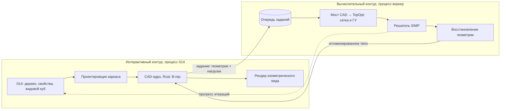
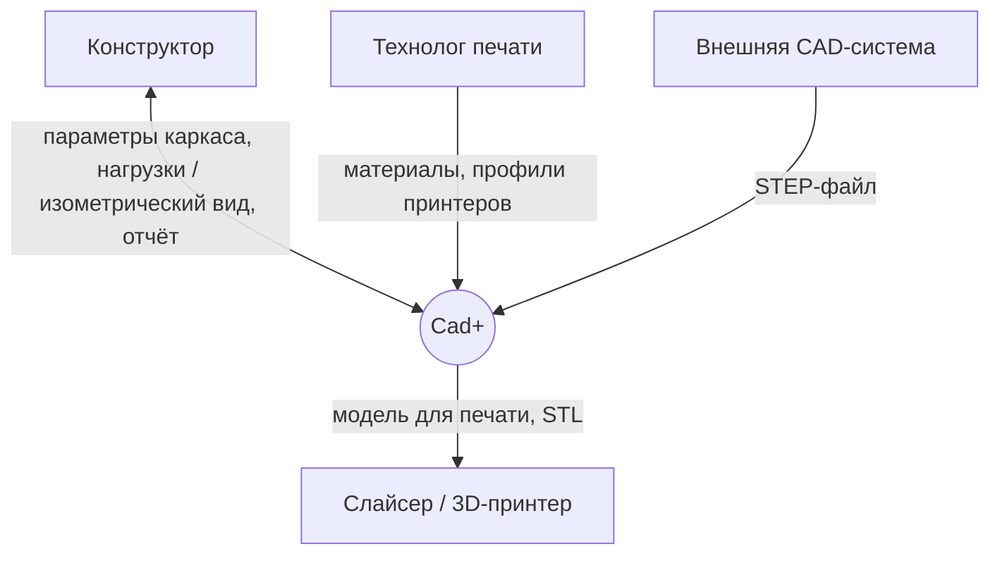
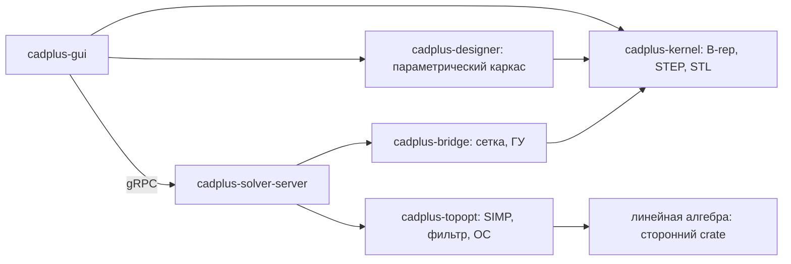
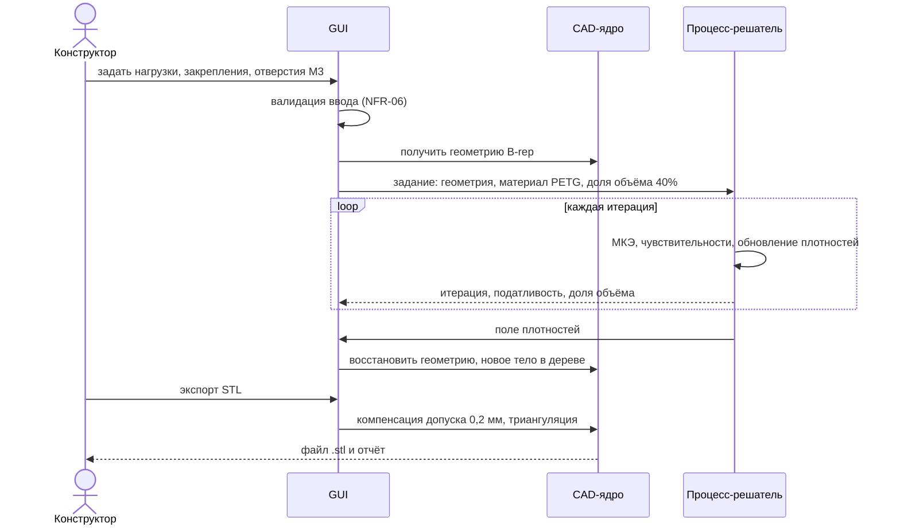
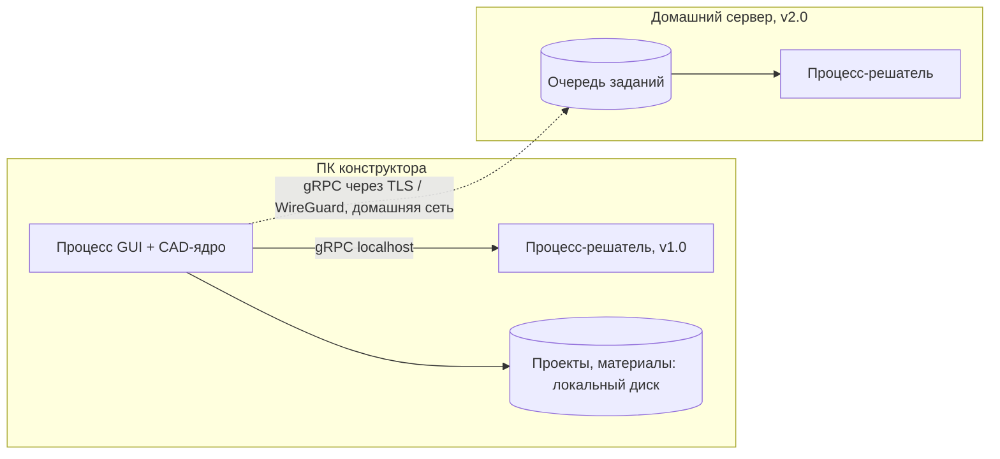
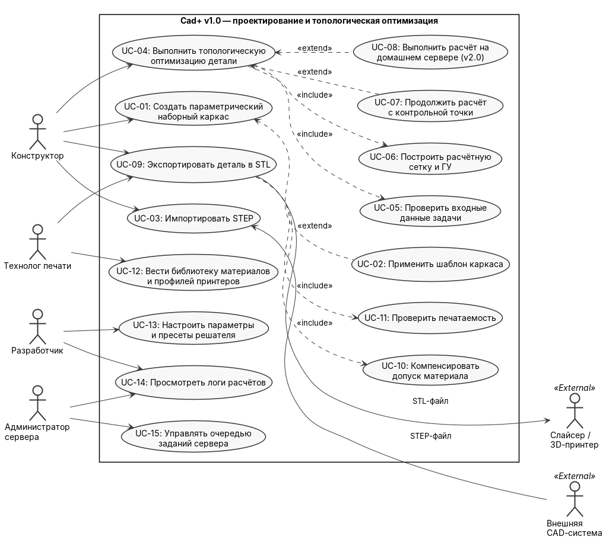
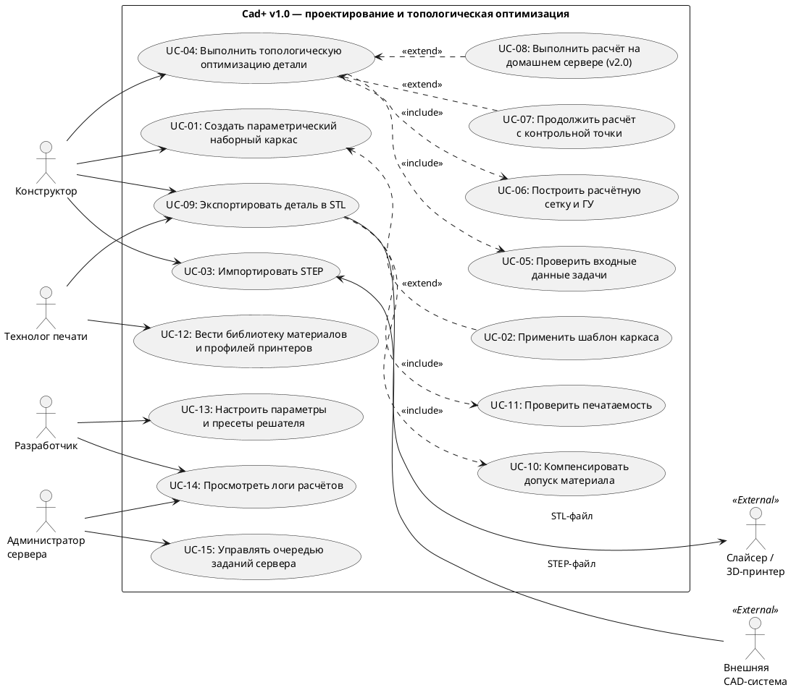

# Cad+ — спецификация требований (SRS) v1.0

> **Практическая работа №1.** Трансформация бизнес-параметров предметной области в спецификацию требований (SRS) — разделы 1–6.
> **Практическая работа №2.** Проектирование динамической модели системы: User Stories, Use Cases и сценарии взаимодействия — разделы 7–9.
> **Дисциплина:** Программная инженерия
> **Тема курсовой работы:** «Программный комплекс Cad+ для параметрического проектирования и топологической оптимизации деталей под 3D-печать (на примере наборного каркаса авиамодели)»
> **Выполнил:** _ФИО_, группа _____  **Дата:** __.__.2026  **Статус:** черновик v1.0
> **Нормативная база:** ГОСТ Р ИСО/МЭК 25010-2015 (модель качества), ГОСТ Р 57100-2025 (описание архитектуры, взамен ГОСТ Р 57100-2016).

## Содержание

1. [Предметная область](#1-предметная-область)
2. [Стейкхолдеры и права доступа](#2-стейкхолдеры-и-права-доступа)
3. [Функциональные требования (FR)](#3-функциональные-требования-fr)
4. [Нефункциональные требования (NFR)](#4-нефункциональные-требования-nfr-по-гост-р-исомэк-25010-2015)
5. [Системные ограничения и допущения](#5-системные-ограничения-constraints-и-допущения)
6. [Описание архитектуры](#6-описание-архитектуры-по-гост-р-57100-2025)
7. [Пользовательские истории (User Stories)](#7-пользовательские-истории-user-stories)
8. [Диаграмма прецедентов (UML Use Case)](#8-диаграмма-прецедентов-uml-use-case)
9. [Спецификация прецедента UC-04](#9-спецификация-критического-прецедента-uc-04)
10. [Глоссарий](#10-глоссарий)

---

## 1. Предметная область

### 1.1 Описание

Cad+ — настольное приложение для конструктора, который проектирует детали под FDM-печать. Типичный пример — силовой набор радиоуправляемой модели самолёта: нервюры, шпангоуты, лонжероны. Деталь должна быть как можно легче, но выдерживать заданные нагрузки. Сейчас для этого нужно несколько программ: CAD для модели, отдельный пакет для расчёта и оптимизации, слайсер для печати. Полученную после оптимизации сетку приходится вручную превращать обратно в редактируемую модель.

Cad+ объединяет эти этапы в одну цепочку:

1. **Проектировщик каркаса** строит параметрическую модель наборного каркаса.
2. **Собственное CAD-ядро** (Rust) строит по ней точную геометрию (B-rep) или читает STEP-файл из внешней CAD-системы.
3. **Мост CAD → TopOpt** готовит расчётную задачу: сетку, нагрузки, закрепления, запретные зоны (отверстия под винты).
4. **Решатель топологической оптимизации** (метод SIMP) убирает лишний материал.
5. Результат **восстанавливается в геометрию**, корректируется на допуск расширения пластика и экспортируется в STL для слайсера. При необходимости деталь можно снова открыть и доработать в CAD.

Разработка ведётся поэтапно: сначала 2D-оптимизация (плоские детали — нервюры, шпангоуты), затем 3D. Сначала приложение работает на ПК пользователя, позже расчёт переносится на домашний сервер.

### 1.2 Бизнес-параметры → системные требования

На этапе предпроектного обследования конструктор сформулировал вводные: «Я печатаю каркас модели самолёта на Bambu A1 (стол 256×256 мм) из PETG. Детали крепятся винтами М3. Пластик при печати расширяется, отверстия выходят меньше на ~0,2 мм. Нужно, чтобы нервюры стали заметно легче без потери прочности, и чтобы это делалось в одной программе с понятным интерфейсом, как в популярных CAD».

Если зашить в код «Bambu A1», «PETG», «М3» и «0,2 мм», программа будет работать только для одного принтера и одного пластика. Поэтому каждая константа превращается в настраиваемый параметр:

| Параметр из брифа | Для конструктора | Для инженера-программиста | Требования |
|---|---|---|---|
| Принтер Bambu A1, стол 256×256 мм | Конкретный принтер | Профиль принтера с настраиваемой областью печати и диаметром сопла | FR-14 |
| Пластик PETG | Конкретный материал | Библиотека материалов с механическими свойствами | FR-12 |
| Винты М3 | Конкретный крепёж | Отверстия с регулируемым диаметром, запретные зоны оптимизации | FR-03 |
| Расширение пластика ~0,2 мм | Опытная поправка | Допуск материала 0,00–1,00 мм и автоматическая компенсация при экспорте | FR-12, FR-13 |
| «Заметно легче без потери прочности» | Желание | Целевая доля объёма и ограничение податливости в постановке задачи | FR-09, FR-15 |
| «Понятный интерфейс, как в популярных CAD» | Удобство | Дерево построения, панель свойств, видовой куб, стандартные горячие клавиши | FR-04, NFR-05 |

---

## 2. Стейкхолдеры и права доступа

### 2.1 Роли

| Роль | Описание |
|---|---|
| **Конструктор** (основной пользователь) | Проектирует каркас, ставит расчётные задачи, запускает оптимизацию, экспортирует детали |
| **Технолог печати** | Ведёт библиотеку материалов и профили принтеров, проверяет печатаемость, готовит STL к печати |
| **Разработчик** (ядро и расчётные модули) | Развивает CAD-ядро и решатель, настраивает параметры решателя, анализирует логи |
| **Администратор сервера** | Обслуживает домашний сервер, на который переносится расчёт (этап v2.0), управляет очередью задач |

### 2.2 Матрица прав доступа

| Функция системы | Конструктор | Технолог печати | Разработчик | Администратор |
|---|:---:|:---:|:---:|:---:|
| Создание и редактирование параметрической модели каркаса | **Да** | Нет | Да (тестовые модели) | Нет |
| Импорт STEP / экспорт STL | Да | Да | Да | Нет |
| Задание нагрузок, закреплений и отверстий под винты | **Да** | Нет | Да | Нет |
| Запуск топооптимизации и просмотр результата | **Да** | Только просмотр | Да | Нет |
| Ведение библиотеки материалов и профилей принтеров | Только выбор | **Да** | Нет | Нет |
| Настройка внутренних параметров решателя (штраф p, фильтр, сходимость) | Только пресеты | Нет | **Да** | Нет |
| Просмотр логов расчётов и профилирование | Нет | Нет | **Да** | Да |
| Управление очередью задач и ресурсами сервера | Нет | Нет | Нет | **Да** |

### 2.3 Архитектурное противоречие и его разрешение

**Противоречие.** Конструктору нужен «живой» интерфейс: изометрический вид вращается плавно, а модель сразу перестраивается при смене параметра. Решатель топооптимизации, наоборот, работает долго и тяжело: сотни итераций МКЭ-расчёта на сетке из 10⁵–10⁶ элементов занимают минуты и часы, загружают все ядра процессора и гигабайты памяти. Если запускать расчёт в том же процессе и потоке, что и интерфейс, окно «зависнет», а аварийное завершение решателя уничтожит несохранённую модель.

**Разрешение аналитика.** Систему делим на два контура (по аналогии с разделением OLTP/OLAP и паттерном «очередь заданий + воркер»):

1. **Интерактивный контур**: GUI, проектировщик каркаса, CAD-ядро, рендеринг. Отвечает за мгновенный отклик и никогда не выполняет тяжёлых расчётов.
2. **Вычислительный контур**: мост CAD → TopOpt и решатель работают в отдельном процессе (воркере). Задания передаются через очередь, прогресс итераций приходит потоком. Процесс-воркер может работать на том же ПК или, без изменения кода, на домашнем сервере.

---

## 3. Функциональные требования (FR)

### Модуль А. Параметрическое моделирование (проектировщик каркаса)

| ID | Название | Формулировка требования | Критерий приёмки |
|---|---|---|---|
| FR-01 | Параметрический наборный каркас | Система должна позволять Конструктору создавать каркас из типовых элементов (нервюра, шпангоут, лонжерон, стрингер) с параметрами: аэродинамический профиль, хорда, толщина, шаг установки. Число элементов в каркасе — от 1 до 500 | Изменение параметра перестраивает модель из 50 элементов ≤ 1 с |
| FR-02 | Дерево построения | Система должна хранить историю построения в виде дерева операций с возможностью редактировать любую операцию и отменять/повторять действия (не менее 100 шагов) | Изменение ранней операции корректно перестраивает все зависимые |
| FR-03 | Отверстия под винты | Система должна позволять задавать отверстия с регулируемым диаметром (1,0–12,0 мм, шаг 0,1 мм) и отмечать область вокруг отверстия как запретную зону оптимизации (материал не удаляется) | После оптимизации вокруг каждого отверстия остаётся кольцо заданной ширины |
| FR-04 | Изометрический вид | Система должна показывать модель в изометрии с вращением, панорамированием и масштабированием мышью, а также стандартными видами (изометрия, спереди, сверху, сбоку) через видовой куб, как в популярных CAD-программах | Переход к стандартному виду в 1 клик |

### Модуль Б. Геометрическое ядро и обмен данными

| ID | Название | Формулировка требования | Критерий приёмки |
|---|---|---|---|
| FR-05 | Импорт STEP | Система должна импортировать STEP-файлы (AP203/AP214) из внешних CAD-систем в граничное представление (B-rep) ядра | Тестовые файлы из 3 разных CAD открываются без потери граней |
| FR-06 | Экспорт STL | Система должна экспортировать тела в STL (двоичный и ASCII) с настраиваемой точностью триангуляции (хордовое отклонение 0,01–0,5 мм) | Полученная сетка замкнута (watertight) и без вырожденных треугольников |
| FR-07 | Проект и шаблоны | Система должна сохранять проект (дерево построения, параметры, расчётные задачи, ссылки на материалы) в открытом текстовом формате (JSON/RON) и сохранять каркас как шаблон для повторного использования | Шаблон нервюры применяется к новому крылу без ручной доработки |

### Модуль В. Расчётная задача и топологическая оптимизация

| ID | Название | Формулировка требования | Критерий приёмки |
|---|---|---|---|
| FR-08 | Постановка расчётной задачи | Система должна позволять задавать нагрузки (сосредоточенная сила, давление), закрепления, область проектирования и запретные зоны в двух режимах: 2D (плоское сечение детали) и 3D (объём) | Задача сохраняется и повторно открывается без потерь |
| FR-09 | Решатель SIMP | Система должна выполнять топологическую оптимизацию методом SIMP: целевая доля объёма 5–95%, показатель штрафа p = 1–5, радиус фильтра плотности, критерий остановки — изменение целевой функции < ε или достигнут лимит итераций (1–1000) | Эталонная задача MBB-балки сходится к известной топологии |
| FR-10 | Прогресс, пауза и отмена | Система должна в реальном времени показывать номер итерации, податливость и долю объёма, а также давать приостановить или отменить расчёт без потери модели | Отмена расчёта ≤ 2 с, модель в GUI не изменилась |
| FR-11 | Восстановление геометрии | Система должна превращать поле плотностей (порог 0,3–0,7) в гладкую геометрию и добавлять её в дерево построения как новое тело, доступное для дальнейшего редактирования | Оптимизированная нервюра открывается в CAD и редактируется |

### Модуль Г. Технологическая подготовка к печати

| ID | Название | Формулировка требования | Критерий приёмки |
|---|---|---|---|
| FR-12 | Библиотека материалов | Система должна позволять Технологу вести справочник материалов (PLA, PETG, ABS и др.): модуль Юнга, коэффициент Пуассона, плотность, допуск на расширение при печати (0,00–1,00 мм, шаг 0,01 мм) | Новый материал доступен Конструктору без перезапуска |
| FR-13 | Компенсация допуска | При экспорте система должна автоматически корректировать размеры отверстий и сопрягаемых поверхностей на величину допуска выбранного материала | Отверстие Ø3,0 при допуске 0,2 экспортируется как Ø3,2 |
| FR-14 | Проверка печатаемости | Система должна проверять, что деталь помещается в область печати выбранного профиля принтера, и предупреждать о стенках тоньше двух диаметров сопла | Деталь 300 мм при столе 256 мм → предупреждение |
| FR-15 | Отчёт об оптимизации | Система должна формировать отчёт: масса до и после, процент облегчения, податливость, максимальные напряжения, параметры расчёта. Экспорт в PDF и CSV | Отчёт открывается в Excel/LibreOffice без правок |

**Итого: 15 функциональных требований.**

---

## 4. Нефункциональные требования (NFR) по ГОСТ Р ИСО/МЭК 25010-2015

Бизнес-контекст: «Чтобы интерфейс был как в популярных CAD, а расчёт не мешал работать». Характеристики и подхарактеристики взяты из модели качества продукта, п. 4.2 стандарта. Эталонный ПК: 4 ядра / 8 потоков, 16 ГБ ОЗУ, видеокарта с поддержкой Vulkan или DirectX 12.

| ID | Характеристика (подхарактеристика, пункт ГОСТ) | Контекст предметной области | Инженерная формулировка требования | Метод проверки |
|---|---|---|---|---|
| NFR-01 | **Уровень производительности** — временные характеристики (4.2.2.1) | Конструктор вращает модель и меняет параметры постоянно | Отклик GUI на действие пользователя ≤ 100 мс. Изометрический вид ≥ 30 кадров/с для модели до 500 000 треугольников на эталонном ПК | Встроенный счётчик FPS, профилировщик |
| NFR-02 | **Уровень производительности** — временные характеристики, потенциальные возможности (4.2.2.1, 4.2.2.3) | Расчёт не должен занимать весь вечер | 2D-задача 200×100 элементов сходится ≤ 30 с. 3D-задача 100 000 элементов ≤ 15 мин на эталонном ПК | Бенчмарк на эталонных задачах |
| NFR-03 | **Уровень производительности** — использование ресурсов (4.2.2.2) | Пока идёт расчёт, ПК используется для других задач | Пиковое потребление ОЗУ решателем ≤ 8 ГБ на 1 млн элементов. Процесс GUI в простое ≤ 1 ГБ. Число потоков решателя настраивается | Мониторинг ресурсов во время бенчмарка |
| NFR-04 | **Совместимость** — функциональная совместимость (4.2.3.2) | Детали приходят из других CAD и уходят в слайсер | STEP AP214 из SolidWorks, Fusion и КОМПАС-3D импортируется без ошибок. STL открывается в Bambu Studio, OrcaSlicer и Cura без исправления сетки | Набор тестовых файлов в CI |
| NFR-05 | **Удобство использования** — изучаемость, управляемость (4.2.4.2, 4.2.4.3) | Пользователь привык к эргономике популярных CAD | Компоновка как в типовых CAD: дерево построения слева, свойства справа, видовой куб, стандартные горячие клавиши. Пользователь, знакомый с Fusion или КОМПАС, без документации строит нервюру с отверстиями ≤ 15 мин | Юзабилити-тест на 3 пользователях |
| NFR-06 | **Удобство использования** — защищённость от ошибки пользователя (4.2.4.4) | Ошибка в параметре может испортить многочасовой расчёт | Ввод проверяется до запуска (отверстие больше детали, нет закреплений, доля объёма вне диапазона). Неверные поля подсвечиваются с текстом причины | UI-тесты на некорректных данных |
| NFR-07 | **Надёжность** — отказоустойчивость (4.2.5.3) | Решатель может упасть на вырожденной сетке | Аварийное завершение процесса-решателя не роняет GUI и не приводит к потере модели. Пользователь получает сообщение об ошибке и лог | Принудительное завершение процесса-решателя |
| NFR-08 | **Надёжность** — восстанавливаемость (4.2.5.4) | Отключение электричества во время долгого расчёта | Автосохранение проекта каждые 2 мин, контрольная точка решателя каждые 10 итераций. После сбоя расчёт продолжается с последней контрольной точки, потеря работы ≤ 2 мин | Тест с прерыванием процесса |
| NFR-09 | **Функциональная пригодность** — функциональная корректность (4.2.1.2) | Неверный расчёт даст деталь, которая сломается в полёте | На эталонных задачах (MBB-балка, консоль) податливость расходится с эталонной реализацией (код Сигмунда «на 99/88 строк») не более чем на 1%. Геометрическая точность ядра — 10⁻⁶ мм | Регрессионные тесты с эталонами |
| NFR-10 | **Сопровождаемость** — модульность, модифицируемость (4.2.7.1, 4.2.7.4) | Подход к моделированию может быть переделан | Ядро, проектировщик, мост и решатель оформлены как отдельные модули (Rust crates) с явными API. Параметрический проектировщик можно заменить другим подходом без изменения ядра и решателя | Code review, граф зависимостей crates |
| NFR-11 | **Сопровождаемость** — тестируемость (4.2.7.5) | Ядро разрабатывается поэтапно с тестами | Покрытие unit- и интеграционными тестами ядра и решателя ≥ 80%. Тесты запускаются в CI (GitHub Actions) при каждом push | Отчёт о покрытии (cargo-llvm-cov) |
| NFR-12 | **Переносимость** — адаптируемость (4.2.8.1) | Расчёт будет перенесён на домашний сервер | Процесс-решатель собирается и работает на Windows 10/11 x64 и Linux x86_64 без изменения кода. Переход «локально → сервер» меняется только настройкой адреса | Сборка в CI под обе ОС |
| NFR-13 | **Переносимость** — устанавливаемость (4.2.8.2) | Приложение должно запускаться как обычная программа | Установка одним установщиком ≤ 5 мин, создаётся ярлык на рабочем столе, приложение запускается двойным щелчком | Установка на чистую систему |
| NFR-14 | **Защищённость** — конфиденциальность, подлинность (4.2.6.1, 4.2.6.5) | Модели — интеллектуальная собственность конструктора | Модели не покидают ПК и домашнюю сеть, облачные сервисы не используются. Связь GUI с удалённым решателем — только по зашифрованному каналу (TLS или WireGuard) с токеном доступа | Анализ сетевого трафика |

**Итого: 14 нефункциональных требований, все 8 характеристик модели качества продукта охвачены.**

---

## 5. Системные ограничения (Constraints) и допущения

### 5.1 Ограничения v1.0

| ID | Ограничение | Формулировка |
|---|---|---|
| Constraint-01 | Технологический стек ядра | CAD-ядро разрабатывается на Rust (stable). OpenCASCADE не используется. В проекте ядра нет Python (ни биндингов, ни тестов) |
| Constraint-02 | Этапность оптимизации | В v1.0 реализуется только 2D-топооптимизация плоских деталей (нервюры, шпангоуты). 3D-режим — в v1.1, после испытаний 2D |
| Constraint-03 | Размещение вычислений | v1.0 — локальное настольное приложение на ПК пользователя. Перенос решателя на домашний сервер — v2.0, только в пределах домашней сети, без облака |
| Constraint-04 | Тип конструкций | Проектировщик v1.0 поддерживает только наборный каркас и призматические детали. Поверхности свободной формы (например, обшивка фюзеляжа) собственными средствами не строятся, но могут быть импортированы через STEP |
| Constraint-05 | Технология производства | Оптимизация учитывает только FDM-печать. Ограничения фрезерования и литья не учитываются |
| Constraint-06 | Модель материала | Линейно-упругий изотропный материал, статическое нагружение. Анизотропия по слоям печати, динамика и усталость в v1.0 не учитываются |
| Constraint-07 | Единицы измерения | Внутри системы используются только мм, Н, МПа. Импорт из дюймовых STEP-файлов пересчитывается при загрузке |

### 5.2 Допущения

- A-01. У пользователя один ПК под Windows 10/11 или Linux с видеокартой, поддерживающей Vulkan или DirectX 12.
- A-02. Данные о материалах (модуль Юнга, допуск) Технолог берёт из паспорта пластика или собственных пробных печатей.
- A-03. Нагрузки на детали задаёт Конструктор; автоматический аэродинамический расчёт нагрузок в задачу не входит.

---

## 6. Описание архитектуры (по ГОСТ Р 57100-2025)

### 6.1 Идентификация описания архитектуры (п. 6.1)

| Поле | Значение |
|---|---|
| Рассматриваемая система | Cad+ — проектировщик каркаса, CAD-ядро, мост CAD → TopOpt, решатель |
| Версия описания / статус | 1.0 / черновик |
| Окружение | ПК конструктора; позже домашний сервер; внешние CAD-системы (STEP); слайсеры (STL) |
| Связанные рабочие продукты | Разделы 3–5 этого документа (SRS); DFD-диаграммы курсовой работы |

### 6.2 Заинтересованные стороны и их интересы (п. 6.2)

| Интерес (concern) | Стейкхолдеры | Где учтён |
|---|---|---|
| Интерфейс не зависает во время расчёта | Конструктор | П2; NFR-01, NFR-07 |
| Оптимизированная деталь прочная и печатается с первого раза | Конструктор, Технолог | П3; FR-13, FR-14, NFR-09 |
| Подход к моделированию можно заменить | Разработчик | П2; NFR-10 |
| Расчёт можно перенести на сервер без переписывания | Разработчик, Администратор | П4; NFR-12, Constraint-03 |
| Модели не уходят в облако | Конструктор | П4; NFR-14 |

### 6.3 Точки зрения и архитектурные представления (п. 6.3–6.4)

| Точка зрения | Представление | Вид модели | Отвечает на интересы |
|---|---|---|---|
| Контекстная | П1. Система и внешние сущности | Контекстная диаграмма (Mermaid flowchart) | Границы системы, обмен файлами |
| Логическая (модульная) | П2. Модули и контуры | Диаграмма компонентов (см. п. 2.3 и ниже) | Отзывчивость GUI, заменяемость модулей |
| Поведенческая | П3. Сценарий оптимизации детали | Диаграмма последовательности | Корректность, печатаемость |
| Развёртывания | П4. ПК и домашний сервер | Диаграмма развёртывания | Переносимость, конфиденциальность |

**П1. Контекстная диаграмма**

**П2. Модули (Rust crates) и их зависимости**

**П3. Сценарий «оптимизировать нервюру»**

**П4. Развёртывание: v1.0 и v2.0**

### 6.4 Архитектурные решения и обоснования (п. 6.6)

| № | Решение | Рассмотренные альтернативы | Обоснование выбора | Требования |
|---|---|---|---|---|
| AD-01 | Решатель в отдельном процессе с очередью заданий | Расчёт в потоке GUI; отдельный поток в том же процессе | Падение решателя не роняет GUI; тот же процесс можно запустить на сервере. Поток в том же процессе проще, но падение в нём завершает всё приложение | NFR-01, NFR-07, NFR-12 |
| AD-02 | Собственное CAD-ядро на Rust | OpenCASCADE через биндинги; готовые Rust-ядра (truck, Fornjot) | OpenCASCADE — тяжёлая C++-зависимость со сложной сборкой. Готовые Rust-ядра пока не поддерживают нужные операции. Собственное ядро позволяет хранить результат оптимизации прямо в дереве построения | Constraint-01, FR-11 |
| AD-03 | Метод SIMP + фильтр плотности + OC | Level-set; BESO | SIMP — стандарт отрасли, хорошо изучен, есть эталонные реализации для проверки. MMA подключается позже, когда понадобится несколько ограничений | FR-09, NFR-09 |
| AD-04 | Связь GUI и решателя по gRPC | stdin/stdout JSON; общая память | gRPC одинаково работает локально и по сети, что упрощает переход на сервер. Общая память быстрее, но работает только на одном ПК | NFR-12, Constraint-03 |
| AD-05 | Проектировщик — отдельный модуль поверх ядра | Параметрика внутри ядра | Позволяет переделать подход к моделированию, не трогая ядро и решатель | NFR-10 |
| AD-06 | Сначала 2D, потом 3D | Сразу 3D | 2D быстрее отлаживается и проверяется на эталонах; плоские детали каркаса покрывают основную задачу | Constraint-02 |

### 6.5 Связи и прослеживаемость (п. 6.5)

Правило связи: каждое требование FR/NFR реализуется хотя бы одним модулем, у каждого модуля есть хотя бы одно требование.

| Модуль | Требования |
|---|---|
| cadplus-gui | FR-04, FR-10, FR-15, NFR-01, NFR-05, NFR-06, NFR-13 |
| cadplus-designer | FR-01, FR-02, FR-03, FR-07, NFR-10 |
| cadplus-kernel | FR-05, FR-06, FR-11, FR-13, NFR-04, NFR-09 |
| cadplus-bridge | FR-08, FR-14 |
| cadplus-topopt | FR-09, NFR-02, NFR-03, NFR-09 |
| cadplus-solver-server | FR-10, NFR-07, NFR-08, NFR-12, NFR-14 |
| Справочник материалов (данные проекта) | FR-12 |
| CI (GitHub Actions) | NFR-04, NFR-11 |

Выявленные рассогласования: нет.

---

## 7. Пользовательские истории (User Stories)

Функциональные требования из раздела 3 записаны в императивном стиле («Система должна…»). Для разработчиков и тестировщиков они переведены в формат Agile: **«Я как [Роль] хочу [Действие], чтобы [Ценность]»**. Каждая история проверяется критериями приёмки (Acceptance Criteria) и соответствует методологии INVEST: независимая, обсуждаемая, ценная, оцениваемая, небольшая, тестируемая.

### US-01. Быстрая правка параметров каркаса (связь с FR-01, FR-02, NFR-01)

**Формулировка:** Я как Конструктор хочу менять хорду, толщину и шаг нервюр в панели свойств и сразу видеть результат в изометрии, чтобы подбирать размеры каркаса без перерисовки модели.

**Acceptance Criteria:**

1. После ввода нового значения и нажатия Enter модель из 50 нервюр перестраивается не более чем за 1 с. Изометрический вид во время перестроения не опускается ниже 30 кадров/с.
2. Значение вне допустимого диапазона (например, толщина < 0,4 мм или хорда ≤ 0) подсвечивается красным с текстом причины. Перестроение не запускается.
3. Ctrl+Z возвращает предыдущее значение параметра, Ctrl+Y повторяет его. Глубина истории — не менее 100 шагов.
4. Изменение параметра ранней операции дерева построения перестраивает все зависимые операции. Если зависимость разорвана, операция помечается значком ошибки, а не удаляется.

### US-02. Отверстия под винты как запретные зоны (связь с FR-03, FR-13)

**Формулировка:** Я как Конструктор хочу ставить отверстия под винты с нужным диаметром так, чтобы оптимизация не вырезала материал вокруг них, чтобы деталь можно было надёжно закрепить.

**Acceptance Criteria:**

1. Диаметр отверстия задаётся в диапазоне 1,0–12,0 мм с шагом 0,1 мм. По умолчанию предлагается 3,0 мм (М3).
2. Вокруг отверстия автоматически создаётся кольцо запретной зоны шириной 0,5–5,0 мм (по умолчанию равно диаметру). После оптимизации плотность всех элементов внутри кольца равна 1.
3. При экспорте диаметр увеличивается на допуск выбранного материала: отверстие Ø3,0 мм при допуске PETG 0,2 мм в STL имеет диаметр 3,2 ± 0,01 мм.
4. Отверстие, которое выходит за контур детали или пересекается с другим отверстием, не создаётся. Выводится сообщение с причиной.

### US-03. Расчёт без зависания интерфейса (связь с FR-09, FR-10, NFR-01, NFR-07)

**Формулировка:** Я как Конструктор хочу запустить топооптимизацию и продолжать работать с моделью, видя ход расчёта, чтобы не ждать перед «замёрзшим» окном и в любой момент остановить неудачный расчёт.

**Acceptance Criteria:**

1. Решатель работает в отдельном процессе. Во время расчёта отклик GUI на действия пользователя — не более 100 мс.
2. Панель прогресса обновляется не реже 1 раза в секунду: номер итерации, податливость, текущая доля объёма, график сходимости.
3. Кнопка «Отменить» останавливает процесс-решатель не более чем за 2 с. Исходная модель не изменяется.
4. При аварийном завершении процесса-решателя GUI продолжает работу и показывает сообщение с кодом ошибки и путём к файлу лога.

### US-04. Импорт детали из другой CAD (связь с FR-05, NFR-04, Constraint-07)

**Формулировка:** Я как Конструктор хочу открыть деталь, сделанную в КОМПАС-3D или Fusion, в формате STEP, чтобы оптимизировать уже существующие детали, а не строить их заново.

**Acceptance Criteria:**

1. Поддерживаются STEP AP203 и AP214. Файл размером до 50 МБ открывается не более чем за 10 с на эталонном ПК.
2. Модель в дюймах автоматически пересчитывается в миллиметры. В строке состояния отображается исходная единица файла.
3. Если в файле есть неподдерживаемые сущности, импорт не прерывается: пользователь получает список пропущенных элементов с их количеством.
4. Импортированное тело появляется в дереве построения отдельным узлом «Импорт STEP» с именем файла.

### US-05. Ведение библиотеки материалов (связь с FR-12)

**Формулировка:** Я как Технолог печати хочу добавлять в библиотеку новый пластик с измеренным мной допуском расширения, чтобы конструктор считал и печатал детали с правильными свойствами.

**Acceptance Criteria:**

1. Карточка материала содержит: модуль Юнга E (100–10 000 МПа), коэффициент Пуассона ν (0,0–0,5), плотность ρ (0,5–2,5 г/см³), допуск на расширение (0,00–1,00 мм, шаг 0,01). Значения вне диапазона не сохраняются.
2. Библиотека хранится в открытом JSON-файле. Новый материал становится доступен Конструктору без перезапуска приложения, не более чем через 2 с после сохранения.
3. Материал, который используется хотя бы в одном проекте, нельзя удалить — только перевести в архив. Архивный материал не предлагается для новых задач.

### US-06. Проверка печатаемости при экспорте (связь с FR-06, FR-14)

**Формулировка:** Я как Технолог печати хочу при экспорте STL сразу видеть, помещается ли деталь на стол принтера и нет ли слишком тонких стенок, чтобы не тратить пластик и время на заведомо неудачную печать.

**Acceptance Criteria:**

1. Габариты детали сравниваются с областью печати выбранного профиля (например, 256×256×256 мм). При превышении выводится предупреждение с фактическими и допустимыми размерами.
2. Стенки тоньше двух диаметров сопла (для сопла 0,4 мм — тоньше 0,8 мм) подсвечиваются на модели цветом и перечисляются в списке.
3. Перед записью файла сетка автоматически проверяется на замкнутость: 0 открытых рёбер и 0 вырожденных треугольников. Незамкнутая сетка не экспортируется.

### US-07. Регрессионная проверка решателя (связь с NFR-09, NFR-11)

**Формулировка:** Я как Разработчик хочу, чтобы решатель автоматически проверялся на эталонных задачах при каждом изменении кода, чтобы ошибка в расчёте не дошла до конструктора и не привела к поломке детали в полёте.

**Acceptance Criteria:**

1. Команда `cargo test` запускает эталонные задачи: MBB-балку и консоль (2D, сетка 60×20).
2. Тест падает, если податливость расходится с эталонным значением (реализация Сигмунда «на 99/88 строк») более чем на 1%.
3. Тесты автоматически запускаются в GitHub Actions при каждом push. Слияние в ветку main при упавших тестах запрещено правилом защиты ветки.

### US-08. Вынос расчёта на домашний сервер (связь с NFR-12, NFR-14, Constraint-03)

**Формулировка:** Я как Администратор сервера хочу подключить GUI к процессу-решателю на домашнем сервере, чтобы тяжёлые 3D-расчёты не загружали ПК конструктора.

**Acceptance Criteria:**

1. Адрес и токен доступа к серверу задаются в настройках. Изменение кода для переключения «локально ↔ сервер» не требуется.
2. Соединение устанавливается только по TLS или через WireGuard. Запрос без действующего токена отклоняется с ошибкой авторизации.
3. Если сервер не отвечает более 5 с при запуске задания, пользователю предлагается выполнить расчёт локально.

**Итого: 8 пользовательских историй, охвачены все 4 роли.**

---

## 8. Диаграмма прецедентов (UML Use Case)

Диаграмма построена в нотации UML 2.5 (PlantUML). Она показывает функциональные границы системы, всех внутренних актёров и внешние системы.

- **Актёры:** Конструктор, Технолог печати, Разработчик, Администратор сервера. На внешнем контуре: Внешняя CAD-система (источник STEP-файлов), Слайсер / 3D-принтер (получатель STL).
- **Связи `<<include>>` (включение):** прецедент «Выполнить топологическую оптимизацию детали» обязательно включает «Проверить входные данные задачи» и «Построить расчётную сетку и ГУ». Прецедент «Экспортировать деталь в STL» обязательно включает «Компенсировать допуск материала» и «Проверить печатаемость».
- **Связи `<<extend>>` (расширение):** «Продолжить расчёт с контрольной точки» расширяет оптимизацию только после сбоя, при наличии контрольной точки. «Выполнить расчёт на домашнем сервере» расширяет оптимизацию только при настроенном сервере (v2.0). «Применить шаблон каркаса» расширяет создание каркаса, если в библиотеке есть шаблоны.

*Рисунок 1. Диаграмма прецедентов Cad+ (UML Use Case).*

Исходный код диаграммы (PlantUML, файл docs/use-case.puml)

---

## 9. Спецификация критического прецедента UC-04

Для Cad+ самый критичный прецедент — топологическая оптимизация. Это самая долгая и ресурсоёмкая операция: она занимает от десятков секунд до десятков минут, загружает процессор и память. Ошибка в ней означает потерю времени конструктора или деталь, которая сломается в полёте.

**Спецификация прецедента UC-04: «Выполнить топологическую оптимизацию детали»**

- **ID и название:** UC-04 «Выполнить топологическую оптимизацию детали».
- **Главный актёр:** Конструктор.
- **Второстепенные актёры:** Технолог печати (косвенно, через данные материала из библиотеки); домашний сервер (только в режиме v2.0, UC-08).
- **Предусловия (Pre-conditions):**
    1. В проекте есть тело (B-rep), построенное в Cad+ или импортированное из STEP.
    2. Для тела выбран материал из библиотеки с заполненными E, ν и ρ.
    3. Процесс-решатель запущен и отвечает на heartbeat по gRPC (localhost).
    4. Свободной оперативной памяти больше, чем оценка для выбранной сетки (оценка показывается до запуска).

- **Основной сценарий (Happy Path):**
    1. Конструктор выделяет нервюру, открывает вкладку «Оптимизация» и выбирает режим 2D (Constraint-02).
    2. Конструктор задаёт закрепления, нагрузки в ньютонах, запретные зоны вокруг двух отверстий М3 (FR-03), целевую долю объёма 40% и пресет решателя «Стандарт».
    3. Конструктор нажимает «Запустить». Система выполняет UC-05 «Проверить входные данные»: есть хотя бы одно закрепление и одна нагрузка, доля объёма в диапазоне 5–95%, нагрузки приложены внутри области проектирования. Проверка пройдена.
    4. Система фиксирует снимок геометрии и параметров с номером ревизии модели (revision = N), создаёт задание с уникальным job_id (UUIDv4) и ставит его в очередь процесса-решателя. Тело блокируется для повторного запуска оптимизации.
    5. Мост CAD → TopOpt выполняет UC-06: строит сетку 200×100 элементов и граничные условия, оценивает потребность в памяти (NFR-03).
    6. Решатель выполняет итерации SIMP: МКЭ-расчёт → чувствительности → фильтр плотности → обновление методом OC. Каждые 10 итераций он пишет контрольную точку на диск (NFR-08).
    7. После каждой итерации решатель отправляет в GUI поток прогресса: номер итерации, податливость, долю объёма. GUI отвечает не дольше 100 мс, конструктор может вращать модель (NFR-01).
    8. Изменение целевой функции становится меньше ε = 0,01. Решатель останавливается и возвращает поле плотностей.
    9. Система сверяет ревизию модели с ревизией задания: они совпадают (N). Выполняется восстановление геометрии по порогу 0,5, результат добавляется в дерево построения новым телом (FR-11).
    10. Система формирует отчёт: масса до и после, процент облегчения, податливость (FR-15). Результат показывается в изометрии, блокировка тела снимается, контрольные точки задания удаляются.

- **Альтернативные сценарии и обработка исключений (Edge Cases):**

    - **Сценарий 3а: Некорректные входные данные (валидация).**
        1. На шаге 3 проверка находит ошибку. Например, у детали нет ни одного закрепления (матрица жёсткости вырождена, расчёт невозможен), запретная зона выходит за контур детали или доля объёма введена как 120%.
        2. Система не создаёт задание и не обращается к решателю.
        3. Ошибочные поля подсвечиваются, выводится сообщение с причиной, например: «Деталь не закреплена: добавьте хотя бы одно закрепление».
        4. Прецедент завершается без расчёта. Модель не изменена.

    - **Сценарий 4а: Изменение модели во время расчёта (Race Condition).**
        1. Пока идёт шаг 7, конструктор продолжает работать и меняет толщину этой же нервюры. Ревизия модели становится N+1.
        2. Если конструктор нажимает «Запустить» повторно для того же тела, система видит блокировку по ID тела. Она предлагает отменить текущее задание или поставить новое в очередь; два активных задания на одно тело не создаются.
        3. На шаге 9 система обнаруживает, что ревизия модели (N+1) не совпадает с ревизией задания (N). Результат не применяется автоматически, иначе оптимизированная геометрия наложилась бы на уже изменённую деталь.
        4. Конструктор видит диалог: «Модель изменилась во время расчёта» с вариантами «Добавить результат отдельным телом», «Перезапустить с новой геометрией», «Отменить». Прецедент продолжается по выбору пользователя.

    - **Сценарий 6а: Аварийное завершение решателя (аппаратный сбой, нехватка памяти).**
        1. На шаге 6 процесс-решатель аварийно завершается: не хватило оперативной памяти или произошла внутренняя ошибка (panic).
        2. GUI фиксирует разрыв gRPC-потока: heartbeat не приходит дольше 3 с.
        3. GUI продолжает работу (NFR-07), модель не изменена. Пользователь видит сообщение с кодом ошибки и путём к логу. При нехватке памяти система предлагает уменьшить сетку и показывает новую оценку памяти.
        4. Система автоматически перезапускает процесс-решатель. Задание помечается статусом Failed с кодом причины.

    - **Сценарий 6б: Отключение питания ПК во время расчёта.**
        1. На шаге 6 пропадает электричество, приложение и решатель завершаются.
        2. При следующем запуске система находит незавершённое задание с контрольной точкой и восстанавливает проект из автосохранения (не старше 2 мин).
        3. Пользователю предлагается «Продолжить расчёт с итерации 120» — выполняется расширение UC-07. Потеря работы — не более 10 итераций.

    - **Сценарий 7а: Обрыв связи с домашним сервером (сеть, режим v2.0).**
        1. Расчёт выполняется на домашнем сервере (UC-08). На шаге 7 сервер не отвечает на heartbeat три раза подряд (15 с).
        2. GUI помечает задание «Связь потеряна», но не отменяет его: сервер продолжает расчёт.
        3. При восстановлении связи GUI переподключается по job_id и догружает пропущенный прогресс.
        4. Если сервер недоступен дольше 5 мин, система предлагает продолжить расчёт локально с последней контрольной точки, полученной до обрыва.

    - **Сценарий 8а: Расчёт не сошёлся.**
        1. На шаге 8 достигнут лимит итераций (по умолчанию 1000), а изменение целевой функции всё ещё больше ε.
        2. Результат помечается «Не сошёлся». Конструктору предлагается сохранить промежуточный результат или перезапустить расчёт с большим лимитом либо другим радиусом фильтра.

- **Постусловия (Post-conditions):**
    - **Успех:** оптимизированное тело добавлено в дерево построения и доступно для редактирования, исходное тело не изменено, отчёт сформирован, контрольные точки удалены, задание в статусе Completed.
    - **Сбой:** исходная модель не изменена и не потеряна, задание в статусе Failed или Cancelled с кодом причины, лог сохранён, память процесса-решателя освобождена.

---

## 10. Глоссарий

| Термин | Определение |
|---|---|
| B-rep | Boundary Representation: граничное представление тела через грани, рёбра и вершины |
| FDM | Fused Deposition Modeling: послойная печать расплавленной пластиковой нитью |
| МКЭ | Метод конечных элементов |
| SIMP | Solid Isotropic Material with Penalization: метод топооптимизации, где у каждого элемента есть плотность 0…1, а жёсткость штрафуется степенью p |
| OC / MMA | Optimality Criteria / Method of Moving Asymptotes: методы обновления плотностей |
| MBB-балка | Эталонная задача топооптимизации (Messerschmitt-Bölkow-Blohm beam) |
| STEP / STL | Форматы обмена: точная CAD-геометрия / треугольная сетка для печати |
| Податливость (compliance) | Мера деформируемости конструкции; при оптимизации её минимизируют |
| Наборный каркас | Конструкция из отдельных силовых элементов: нервюр, шпангоутов, лонжеронов, стрингеров |
| User Story / INVEST | Пользовательская история в формате «Я как… хочу… чтобы…»; INVEST — критерии качества истории: Independent, Negotiable, Valuable, Estimable, Small, Testable |
| Race Condition | Состояние гонки: результат зависит от порядка одновременных действий (здесь — правка модели во время расчёта) |
| Контрольная точка (checkpoint) | Сохранённое на диск промежуточное состояние решателя, с которого можно продолжить расчёт после сбоя |
| Heartbeat | Периодический сигнал «я жив» между GUI и процессом-решателем для обнаружения обрыва связи |
